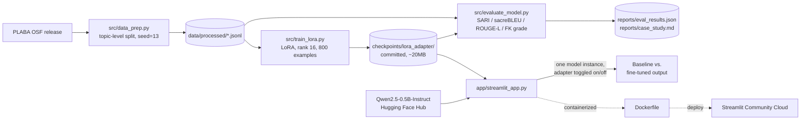

# Clinical Text Simplifier

LoRA fine-tuning of a small open instruct LLM (`Qwen2.5-0.5B-Instruct`) to rewrite
biomedical sentences in plain language, evaluated against **PLABA**
(Plain Language Adaptation of Biomedical Abstracts) — a real, NIH/NLM-released
dataset of professionally-written plain-language simplifications of PubMed
abstract sentences.

**The question:** does roughly an hour of CPU-only LoRA fine-tuning on a
reduced-scope 800-example subset measurably improve a 0.5B-parameter model's
ability to simplify clinical text, versus just prompting the same base model
zero-shot?

📄 **[Read the case study](reports/case_study.md)** — full methodology, real
metrics (baseline vs. fine-tuned), qualitative examples (including a real
failure mode), and honest limitations.

🖥️ **Live demo:** `<add the Streamlit Community Cloud URL here once deployed>` — or
run it locally / via Docker in 2 minutes, see [Running the demo](#running-the-demo)
below.

## Architecture



The demo app loads the base model **once** and toggles the LoRA adapter on/off
with PEFT's `disable_adapter()` context manager rather than holding two full
model copies in memory — the same discipline `src/evaluate_model.py` uses,
important on a CPU-only free-tier host.

## Results

Real numbers from 200 held-out PLABA test sentences never seen in training
(`reports/eval_results.json`, full 200-example scoring in
`reports/qualitative_examples.json`):

| Metric | Zero-shot baseline | LoRA fine-tuned | Change |
|---|---|---|---|
| SARI | 29.04 | **34.11** | +5.06 |
| sacreBLEU | 9.48 | **17.40** | +7.92 (+83%) |
| ROUGE-L | 0.295 | **0.380** | +0.084 |
| FK grade delta (output vs. source) | -2.36 | **-3.51** | more aggressive simplification |

**The fine-tune improved every metric measured** — not a given for one epoch
over 800 examples. It also isn't a clean win: the fine-tuned model simplifies
*more* than actual human annotators do by grade level, and at least one
output truncates into an apparently invented number. Both the win and the
failure mode are shown with real, unedited model outputs in the case study.

## The data

- **[PLABA](https://bionlp.nlm.nih.gov/plaba2024/)** (Attal et al. 2023, *Scientific
  Data*): 75 consumer-health topics, ~10 PubMed abstracts per topic, each abstract
  sentence adapted into plain language by one or more professional annotators.
  Downloaded directly from the dataset's official OSF release
  (`https://osf.io/download/4kp7v`, linked from the PLABA-2024 TREC shared task
  page) — not scraped, not synthesized.
- **Why not the official TREC test split?** The PLABA-2024 shared task's held-out
  test set lives behind NIST's "active participants" area and requires shared-task
  registration that can't be completed in this non-interactive environment. Instead
  this project carves its own train/val/test split out of the public release,
  splitting **by topic** (52 train / 11 val / 12 test topics) so no topic's subject
  matter leaks across splits. This is a documented substitution, not a silent one.
- Resulting splits (`src/data_prep.py`, deterministic, seed=13):
  **6,202 train / 1,085 val / 1,242 test** sentence pairs. Val/test rows keep
  *every* available human reference per source sentence (some articles have more
  than one independent annotator), for proper multi-reference SARI/BLEU scoring.

## Modeling approach

- **CPU-only**, no GPU used or required (4-core/8-thread laptop CPU, 8GB RAM)
  — see the case study for the smoke-test and throughput-benchmark steps that
  validated and sized this before committing to a full run (this user has hit
  a Windows OOM issue on a past project; the same discipline applies here).
- **Model:** [`Qwen/Qwen2.5-0.5B-Instruct`](https://huggingface.co/Qwen/Qwen2.5-0.5B-Instruct)
  (Apache 2.0, 496M params) — the smallest widely-used open instruction-tuned
  model with a plausible shot at a measurable fine-tuning effect on CPU.
- **Method:** LoRA via Hugging Face `peft` (rank 16, alpha 32, dropout 0.05,
  targeting `q_proj/k_proj/v_proj/o_proj`, 0.44% of params trainable), not
  full fine-tuning.
- **Real, reduced-scope training run:** a smoke test and throughput benchmark
  showed a full epoch over all 6,202 training examples would take ~9 hours on
  this CPU — infeasible. The real run used **800 training examples, 1 epoch,
  batch_size=1, grad_accum=8** (~59 minutes wall-clock), a documented scope
  reduction rather than a silently smaller "full" claim. See the case study's
  "Modeling approach" section for the throughput numbers that drove this.
- Prompt format, training objective, and generation all share one prompt builder
  (`src/prompting.py`) so training and inference are never subtly out of sync.

## Business relevance

Clinician-written text (discharge summaries, abstract findings, lab
narratives) is routinely handed to patients unsimplified — a real health-
literacy and comprehension gap, not a hypothetical one. The concrete result
here is that a small, cheap-to-run model *can* be measurably improved at this
task with under an hour of CPU fine-tuning on a few hundred examples, which
matters for the actual deployment question: a 0.5B model that runs on a CPU
is a fraction of the cost/latency of routing every simplification request
through a frontier API model. But the case study's honestly-reported failure
modes (dropped clinical content, an invented number) are the real finding for
this use case: **metric improvement is not the same claim as "safe for
unsupervised patient-facing use."** Any real deployment of this pattern would
need a human-in-the-loop review step, not a fire-and-forget rewrite.

## Scalability considerations

- **CPU-only inference is the point, not a limitation to route around** — a
  0.5B model is deliberately small enough to run without a GPU; the demo app
  above generates both outputs in a few seconds per sentence on ordinary
  hardware. Batching multiple sentences would trade latency for throughput if
  this ran on real document volume instead of single-sentence demo queries.
- **Training was explicitly scoped down after measuring, not guessing** — a
  throughput benchmark (`src/bench_throughput.py`) showed the full 6,202-
  example train split would take ~9 hours on this CPU; the real run used 800
  examples (~59 minutes). A production version would either accept that
  training-time cost on better hardware or continue the same small-subset
  approach with more careful example selection.
- **The base model downloads from the Hugging Face Hub on first run** (~1GB) —
  cached after that. The committed LoRA adapter is ~20MB, small enough to
  ship directly in the repo rather than needing separate artifact hosting.

## Monitoring (stated plan, not built)

A real deployment of this pattern would track, at minimum: a **faithfulness
check** (does the simplified output still entail the source sentence's
claims — the case study's own invented-number failure is exactly the kind of
regression this would catch that SARI/BLEU miss), **readability delta**
trending per request (is it actually getting simpler, not just shorter), and
**a human-review sampling rate** on live output given the documented failure
modes, rather than treating this as a fire-and-forget rewrite service.

## Structure
```
app/
  streamlit_app.py      # interactive demo: baseline vs. fine-tuned, side by side
src/
  data_prep.py         # builds data/processed/{train,val,test}.jsonl from the raw PLABA release
  prompting.py         # single source of truth for the instruction prompt format
  train_lora.py        # LoRA fine-tuning (supports --smoke_test for a fast validation run)
  bench_throughput.py  # ad hoc CPU throughput benchmark used to size the real training run
  evaluate_model.py    # baseline (zero-shot) vs. fine-tuned scoring: SARI/BLEU/ROUGE/FK grade
data/
  raw/plaba_data.json         # downloaded from OSF, gitignored (see Setup)
  processed/{train,val,test}.jsonl  # regenerated by data_prep.py, gitignored
checkpoints/
  lora_adapter/          # the trained LoRA adapter -- committed on purpose, ~20MB
  _trainer_tmp/           # HF Trainer scratch dir, gitignored
reports/
  case_study.md              # full write-up
  eval_results.json          # raw metric numbers from the real eval run
  qualitative_examples.json  # real before/after model outputs, all 200 scored examples
  _gen_cache/                # cached raw generations, gitignored (regenerated by evaluate_model.py)
Dockerfile
requirements.txt
```

## Setup

```
python -m venv venv
venv\Scripts\activate      # or source venv/bin/activate on macOS/Linux
pip install -r requirements.txt
```

## Running the demo

The committed LoRA adapter (`checkpoints/lora_adapter/`) means the demo needs
no training step -- just the base model, which downloads from the Hugging
Face Hub on first run (~1GB, cached after that).

```
streamlit run app/streamlit_app.py
```

Or with Docker:
```
docker build -t clinical-text-simplifier .
docker run -p 8501:8501 clinical-text-simplifier
```

Then open `http://localhost:8501`.

## Reproducing the training run

Download the raw dataset (public PLABA release, ~3MB):
```
curl -L "https://osf.io/download/4kp7v" -o data/raw/plaba_data.json
```

Build the train/val/test splits:
```
python src/data_prep.py
```

Smoke test the training loop (tiny subset, ~1 minute, confirms no OOM before
committing to a full run):
```
python src/train_lora.py --smoke_test
```

Full LoRA fine-tuning run (real config used for this project's reported
results — ~800 examples, 1 epoch, ~59 minutes on a 4-core CPU; see the case
study for why the scope is smaller than the full 6,202-example train split):
```
python src/train_lora.py --max_train_samples 800 --epochs 1 --output_dir checkpoints/lora_adapter
```

Evaluate baseline vs. fine-tuned on the held-out test split (real run scored
the first 200 of 1,242 test sentences, ~37 minutes for both models):
```
python src/evaluate_model.py --adapter_dir checkpoints/lora_adapter --limit 200
```

## License

MIT — see [LICENSE](LICENSE).
